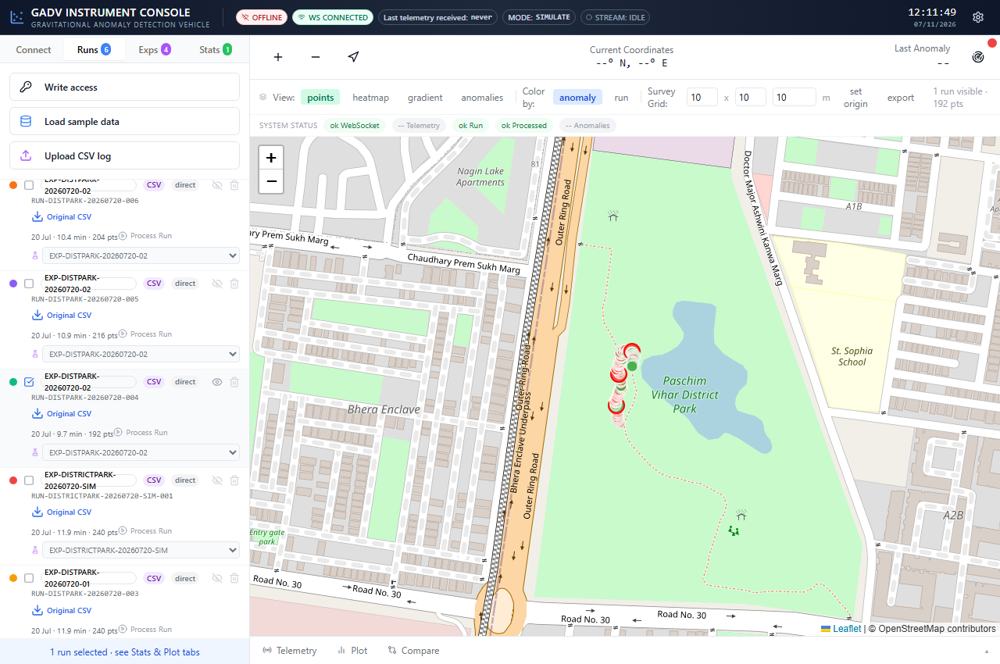
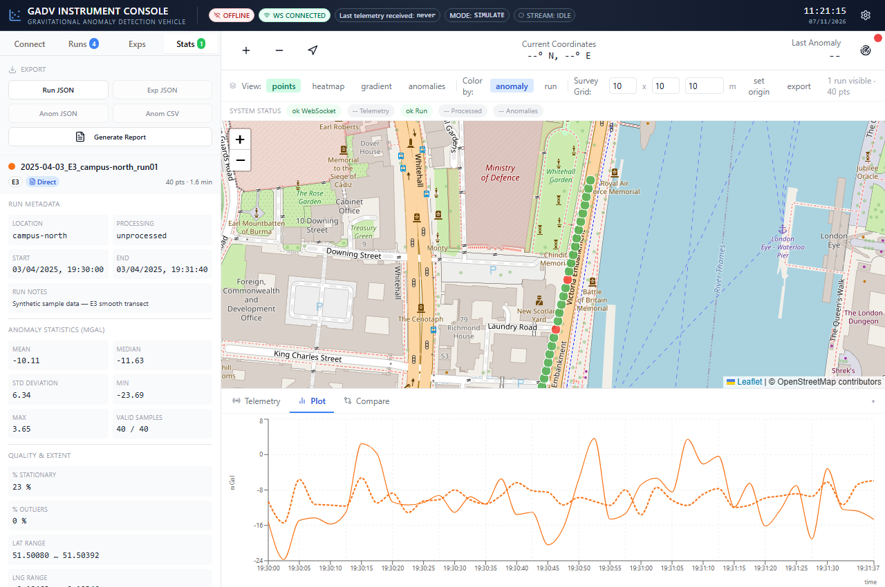

# GravityMapper

GravityMapper is the web-based telemetry, visualization, and data-analysis component of GADV, a broader rover engineering project. Mechanical CAD, electronics, and PCB development are maintained separately.

[](docs/media/district-park-run.png)

District Park, Paschim Vihar, New Delhi — field-route CSV `RUN-DISTPARK-20260720-004` (192 samples), visualized in GravityMapper. Early GADV repeatability target: ±15 mGal; displayed values are exploratory anomaly proxies.

[Live dashboard](https://gravitymapper.onrender.com/)

## Why I Built It

I built GravityMapper to bring incoming rover readings, their locations, and run comparisons into one place. Seeing a stream of numbers is useful, but plotting it on a map and recording it as a run makes changes easier to inspect. The same interface supports live telemetry, synthetic examples, and imported CSV files.

## What It Does

The dashboard receives telemetry over WebSocket or HTTP, records runs, groups them into experiments, and displays statistics and plots. Maps can show points, interpolated heatmaps, gradients, and detected regions. A survey grid helps track coverage. Data and summaries can be exported as CSV, JSON, or a Markdown report.

The Python pipeline processes raw sensor logs with tilt compensation, altitude and latitude corrections, smoothing, and outlier filtering. Processed CSV files can also be imported directly.

## Application Preview

[](docs/media/run-analysis.png)

Plots and statistics for a built-in synthetic demonstration run, illustrating the application's analytical capabilities. These example values are not physical measurements. Open either image for full-size labels.

## Technology and Layout

The frontend uses React, TypeScript, Vite, Leaflet, and Recharts. Express serves the API, the WebSocket bridge, and the built frontend. Python processing uses NumPy and pandas.

- `app/client/`: dashboard
- `app/server/`: API, telemetry, CSV processing, and PostgreSQL-backed run storage
- `app/shared/`: shared schemas and types
- `analysis/scripts/gravity_pipeline.py`: processing pipeline
- `data/raw/sample_log_template.csv`: synthetic CSV example

## Run Locally

Use Node.js 24 and npm 11. From the repository root:

```sh
npm ci
npm run db:migrate
npm run dev
```

Open <http://localhost:5000>. In PowerShell, use `npm.cmd` if execution policy blocks `npm`.

Set `DATABASE_URL` to persistent PostgreSQL and `GADV_WRITE_TOKEN` to a random secret of at least 32 characters before migrating and starting. Enter the token through **Write access** in the Runs tab when uploading or editing data. Without database configuration, imports and recordings cannot be saved. See the deployment guide for setup and legacy JSON transfer.

For raw CSV processing and Process Run, install Python 3.11+ and the analysis requirements:

```sh
python -m pip install -r analysis/requirements.txt
python analysis/scripts/gravity_pipeline.py data/raw/sample_log_template.csv
```

Use `npm run check` and `npm run build` to check types and produce `dist/public` and `dist/index.js`. See the [deployment guide](RENDER_DEPLOYMENT.md) and [data reference](docs/data-format.md) for runtime details.

## Measurement Limits

Sensor-derived anomaly values are proxies, not calibrated gravitational measurements. Synthetic examples are demonstration data. Heatmaps, gradients, and relative region scores help inspect the input; they do not establish geological findings or detection accuracy.

## Development

I set the goals and data workflows, contributed original code, and directed testing and revisions. ChatGPT, Codex and Replit Agent contributed substantial software implementation and debugging.

Selected software-development records:

- [April 2026 dashboard requirements](https://github.com/Radhe-Dhoundiyal/GravityMapper/blob/c69c3afee3cdbccfba052f0723b525f12df35fb6/attached_assets/Pasted-This-repository-is-a-research-project-called-GADV-Gravi_1775113646946.txt): recorded experiment, optional-sensor, CSV, and run-comparison requirements.
- [April 2026 telemetry failure report and correction](https://github.com/Radhe-Dhoundiyal/GravityMapper/commit/830931c7475677bf15576448b31febc45a3d066d): the reported blank live state, shared-ingestion requirement, and Replit Agent callback/state changes.
- [November 2026 sensor-validity and database regression checks](https://github.com/Radhe-Dhoundiyal/GravityMapper/pull/3): later corrections and automated tests for missing measurements, GPS validity, processing, and durable storage.

## License

See [LICENSE](LICENSE).
